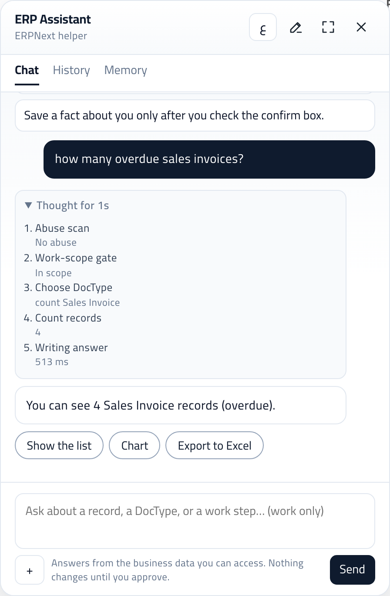
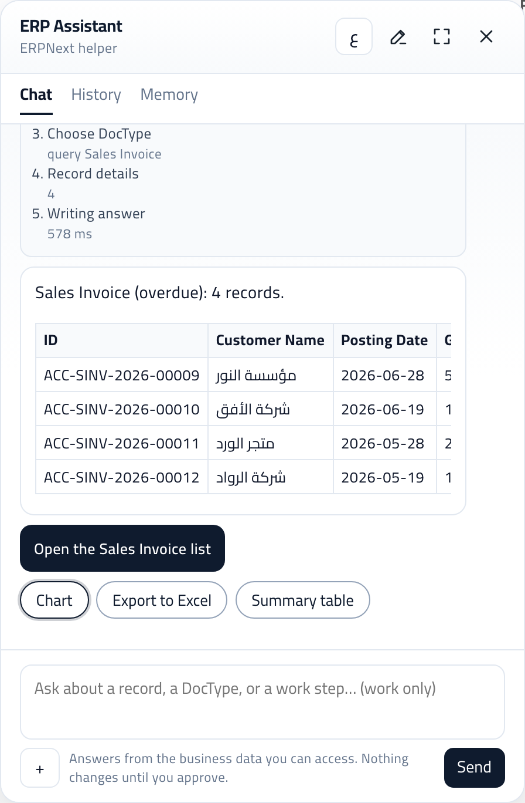
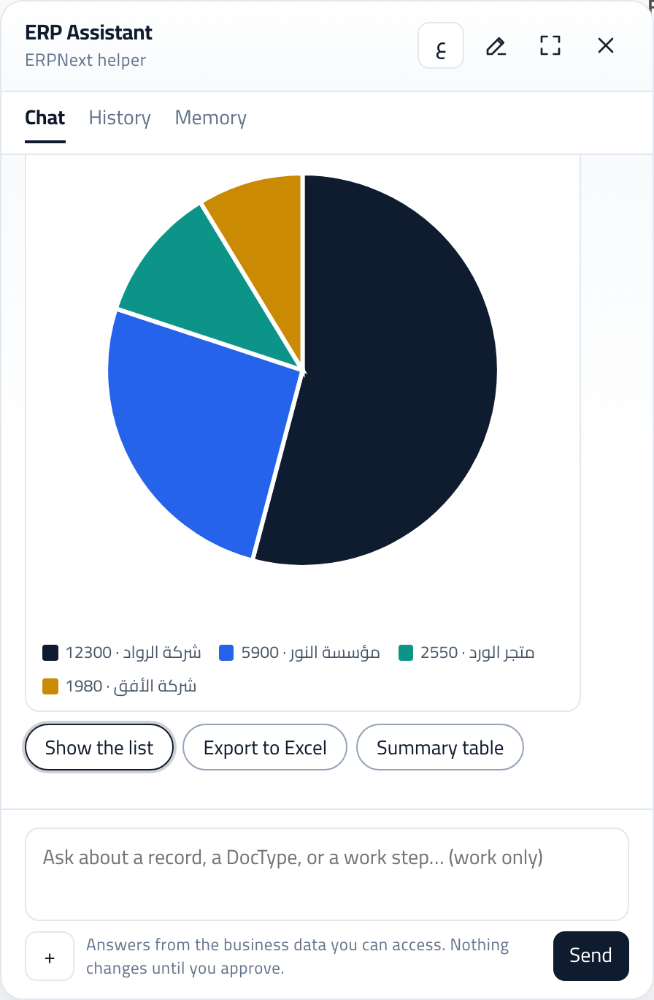
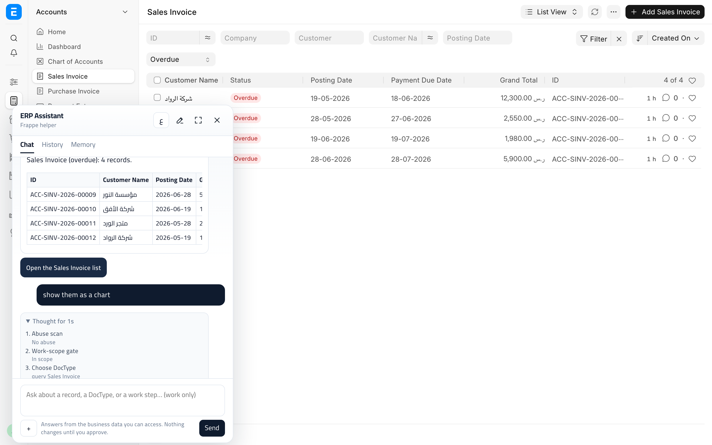
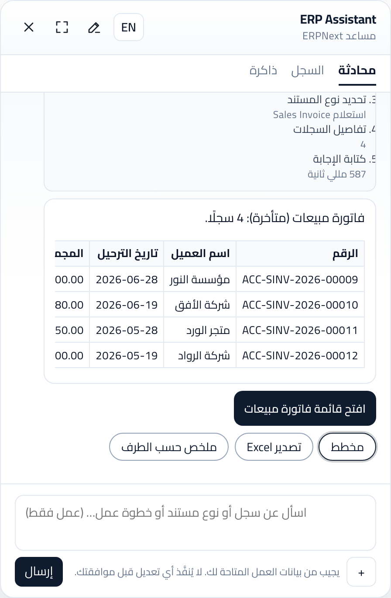

# The ERPNext-AI-Assistant

[](https://frappeframework.com)
[](https://erpnext.com)
[](#what-you-can-do-today)
[](license.txt)
[](mailto:ahmad18189@gmail.com)

**Ask your Frappe site in Arabic or English, from the Desk you already use.**

Count customers, open Data Import, sketch a chart, or prepare a new record. The answer uses the records your login can already open. A new record, a change, or an import waits until you press Approve.

Made by **Ahmed Abdelrahman**. Support: [ahmad18189@gmail.com](mailto:ahmad18189@gmail.com).

`#frappe` `#erpnext` `#arabic` `#ai-assistant` `#hrms` `#crm` `#data-import` `#rtl` `#openai` `#desk`

## A chat panel on your site

Staff stay in Desk. The panel sits on the page, in Arabic or English, and follows the apps you have installed. A site with only Frappe can still ask about tasks, events, and notes. When ERPNext, HR, CRM, or your own app is installed, the same panel can talk about those records too.

Guests stay out. Each person sees the records their role already allows.


*The English panel, ready to ask for a chart. Switch to Arabic with one button.*

## See it work

Ask a question, get a number you can check, then one click to see the records, a chart, or the same list in Desk.

| 1. Ask | 2. Show the list | 3. Chart |
|---|---|---|
|  |  |  |

**4. Open the same list in Desk.** "Open the Sales Invoice list" lands on the filtered list, with the conversation still open beside it:



**In Arabic.** The panel opens in the user's ERPNext language. "كم عدد الفواتير المتأخرة" then "عرض القائمة":



*Screenshots from a demo company on Frappe 16.53 / ERPNext 16.52.*

## What you can do today

| You say | What you get |
|---|---|
| كم عدد الفواتير المتأخرة / How many overdue invoices? | "4 (overdue)", the count your login can see, with buttons: **Show the list · Chart · Export to Excel** |
| Show the list (one click) | The invoices themselves: number, customer, date, total, status, and a button that opens the same filtered list in Desk |
| How many submitted sales orders? | Status words count: submitted, draft, cancelled, overdue, paid, unpaid, open, completed, in Arabic and English |
| Show a chart of sales invoices by customer | A chart grouped by the field you named, with the numbers written out |
| Create a quotation for Delta Systems for 2 laptops and 1 printer | A ready card: customer, item lines with prices, total, and company, currency and price list filled in for you. Approve saves it |
| أنشئ عرض سعر لشركة الأفق لعدد 3 كراسي مكتب | The same in Arabic, Arabic plurals included |
| Submit the draft invoice for مؤسسة النور | A card for that real invoice. If there is no matching draft, it says so instead of guessing |
| Show them / اعرضها / which one is biggest? | Follow-ups keep the previous question's filters |
| cancel / إلغاء | Drops a half-finished draft |
| Open the import tool / افتح أداة الاستيراد | A button that opens Data Import on this site |
| Here is my spreadsheet | A check of the columns, then an import after you approve |

Today the assistant can:

- Answer a work question about this site. Ask in Arabic and the reply comes back in Arabic. The panel itself opens in your ERPNext language.
- Count and list records your role can read, understand status words and "for <customer>", and draw a chart grouped the way you ask.
- Offer one-click next steps after a count: the records themselves, a chart, or an Excel file.
- Prepare a quotation or order from one sentence. The customer and items come from your words; company, currency, price list, series and exchange rates are filled the way the Desk form fills them. Delivery dates are asked for, never guessed.
- Change, submit, cancel, or delete a record through a card that names the real record, shows before → after, and checks it is in the right state and that you may change it.
- Keep the thread: "show them", "export them", "which one is biggest" continue the last question.
- Show its work while it runs: the steps appear live under your question.
- Open a Desk page, such as Data Import.
- Read a spreadsheet, line the headers up, and start the import after you approve.
- Explain a how-to step from the ERPNext manual when ERPNext is installed.
- Remember a fact about you after you tick confirm.

You bring an OpenAI-compatible key and keep it in ERP AI Settings. The panel runs on your site.

## What we are building toward

A companion for the Frappe site a company already runs. Someone in sales, finance, HR, or the back office asks in the language they work in, lands on the right screen, and leaves with an answer they could have opened themselves. The same standard stays: your role decides what you can see, and Approve decides what gets saved.

## What's next

The next releases follow the questions teams already ask:

- More of the apps and records already installed on the site, so a question about stock, invoices, people, or a custom app lands in the right place.
- A short choice when one question could belong to two apps, so the answer matches the work in front of you.
- Charts, lists, and imports for more of the everyday jobs, still with the numbers written in a sentence you can check.
- The same promise on every new job: you see it, then you approve it, then it is saved.

## The open-source assistants beside this one

Thank you to the people building chat for Frappe and ERPNext in the open. [ChangAI](https://github.com/ERPGulf/changai), [Frappe Assistant Core](https://github.com/buildswithpaul/Frappe_Assistant_Core), [Frappe AI](https://github.com/vyogotech/frappe_ai), and [LazyChat](https://github.com/soumyasethy/lazychat-erpnext) are real projects, with real maintainers, and this app is glad they exist. Try them. File an issue. Translate a screen. Send a pull request to the one you use. A fix in any of these projects makes the whole community better.

The table is a way to choose, from each project's public page in 2026. Install the one that matches the site you have, use it on real work, and tell that project what should come next.

| | This app | [ChangAI](https://github.com/ERPGulf/changai) | [Frappe Assistant Core](https://github.com/buildswithpaul/Frappe_Assistant_Core) | [Frappe AI](https://github.com/vyogotech/frappe_ai) | [LazyChat](https://github.com/soumyasethy/lazychat-erpnext) |
|---|---|---|---|---|---|
| Where you talk | A panel on your Desk | Inside ERPNext | Free connection for Claude, ChatGPT, or Cursor. The in-Desk chat is their cloud plan | A Desk sidebar that calls an agent you host | Inside ERPNext |
| Frappe without ERPNext | Yes. Tasks, events, and notes still work | Built for ERPNext | Built for ERPNext and Frappe data | Frappe and ERPNext | ERPNext |
| Arabic and English | Both, with a button on the panel | English and Arabic | The cloud chat can speak in your language | Your agent decides | Your model decides |
| Who pays for the model | Your OpenAI-compatible key | Gemini, Claude, or a server you run | Your key for the free connection. A subscription for the in-Desk chat | The agent service you run | Your own model key |
| Saving records | You press Approve | Questions first. Actions are still growing | The cloud chat shows the change and waits | Depends on the agent you connect | You apply each change |
| License | MIT | MIT | AGPL-3.0 for the open core | MIT | MIT |

A good fit looks like this:

- **This app** when you want Arabic and English on your own Desk, including a Frappe site that has not installed ERPNext, and you want to press Approve before a record is saved.
- **ChangAI** when you want plain-language questions on ERPNext, including Arabic, with Gemini or a server you run.
- **Frappe Assistant Core** when your team already works in Claude, ChatGPT, or Cursor and wants the site connected there. Their in-Desk chat is a separate cloud plan.
- **Frappe AI** when you want a Desk sidebar and you are ready to host the agent yourself.
- **LazyChat** when you want an ERPNext chat on your own model and you want to apply each change yourself.

Use one this week. If it is the right home for a bug or an idea, contribute it there. If a later week needs a different shape, try the next project and contribute there too.

## Questions people ask

**Does it work without ERPNext?**  
Yes. Tasks, events, and notes are enough for a Frappe-only site.

**Will a record change while I am still reading the answer?**  
Creates, updates, and imports wait until you press Approve.

**Which languages does it speak?**  
Arabic and English. One button switches the panel. An Arabic question gets an Arabic reply.

**Who is it for?**  
Companies that already use Frappe or ERPNext and want staff to ask from the Desk they open every day.

**Do I need another subscription for the chat?**  
You need your own model key. The panel itself is part of this app.

## Support

**Ahmed Abdelrahman**  
Email: [ahmad18189@gmail.com](mailto:ahmad18189@gmail.com)

Write with your Frappe version, the question you asked, and what the assistant replied. Leave the API key out of the email.

## Install

Frappe v16. ERPNext, HR, and CRM are optional.

```bash
cd /path/to/frappe-bench
bench get-app https://github.com/ahmad18189/erpnext_ai_assistant.git
bench --site your.site install-app erpnext_ai_assistant
bench --site your.site migrate
bench build --app erpnext_ai_assistant
bench --site your.site clear-cache
```

A new site gets a working starting point: settings, the Frappe helper, and the core skill. A value you already saved stays as you left it. Extra skills for ERPNext, CRM, HR, stock, and finance appear only when that app is installed.

### Add your key

1. Desk: ERP AI Settings → API Key
2. Or on the server, in `site_config.json`:

```json
{
  "erp_ai_openai_api_key": "YOUR_OPENAI_API_KEY"
}
```

3. Or the environment variables `OPENAI_API_KEY` or `ERP_AI_API_KEY`

Keep the key on the server. It does not belong in this repository. Install never writes the key, and it never overwrites a value you already saved, including a daily call cap of 0.

Optional Settings fields: `provider_base_url` (default OpenAI), `model` (default `gpt-4o-mini`), temperature, max tokens, panel title and hints, Overlay Pages, and abuse thresholds.

The panel opens on `/desk`, `/app`, and each installed app route from `add_to_apps_screen` or `app_icon_route`. Add or hide a path under ERP AI Settings → Overlay Pages.

### A spreadsheet in the chat

You can attach a picture, CSV, Excel file, PDF, or text file up to 5 MB. The file stays private to you.

- A picture is read so the assistant can talk about it.
- A CSV or Excel file is matched to a Data Import layout. You see which columns fit, which required fields are missing, and a blank header you can download.
- When the file matches one list you are allowed to import, Approve creates the import and starts it. The reply then tells you whether it succeeded, partly succeeded, failed, timed out, or is still running. Failed rows can be downloaded.

## What it does

| Capability | Behavior |
|---|---|
| Chat panel | FAB and overlay on Desk and on every installed app route. Opens in the user's ERPNext language (a manual switch lasts the browser session). Icon buttons for new chat, expand, and close, with labels in that language |
| Live steps | Each step of a turn appears while it runs (realtime, user room, matched by request id) |
| Live reads | Session-user `get_list` / `count_records` / `get_doc` — **no** `ignore_permissions`. Counts and lists apply status words and "for <party>"; "X by Y" groups by Y |
| Next steps | After a count or list: Show the list · Chart · Export to Excel. Each button sends a fixed follow-up through the normal chat |
| Records list | The matching records (number, party, date, total, status, newest 10) with an Open list button that keeps simple filters in Desk |
| Follow-ups | "show them", "اعرضها", "the biggest one" reuse the last question's DocType and filters; "cancel / إلغاء" drops a draft |
| Arabic labels | Translated DocType and field index. A field name is used only when exactly one readable field matches |
| Desk links | "Open the import tool" returns a same-site `/desk/...` button. The model cannot supply the path |
| Writes | Schema check, system fields filled from company and settings defaults, customer and item rows read from the sentence, then one missing business field at a time, then **ERP AI Pending Action**. The card names the real record, shows before → after or item lines and a total, and refuses records in the wrong state. Nothing is saved until you approve |
| Personas | Roles first, then route, then the app implied by the message. A blank active persona is Frappe helper |
| Memory | Confirmed user facts only, plus rolling chat facts so a follow-up keeps the chosen DocType |
| Charts | Server-built SVG charts (no heavy chart libraries in the panel) |
| Numbers you can check | Count answers name what was counted; a model-written number is followed by a "Checked:" line built from the tool result |
| Moderation | Abuse term scan → event → threshold block; work-only gate before the model |
| Gaps | Unfinished turns are stored on **ERP AI Enhancement** for a later release. The model does not implement them |
| LLM | OpenAI-compatible chat. The model chooses an allowlisted tool; the server checks permission and schema |

Permissions and Frappe roles always win. Guests cannot chat.

## Architecture

```
┌─────────────────────────────────────────────────────────────┐
│  Any installed app + Desk                                  │
│  App routes from hooks → Overlay Pages → panel JS/CSS      │
│  FAB + panel (Cairo / RTL / navy)                           │
└───────────────────────────┬─────────────────────────────────┘
                            │ frappe.call run / approve_action
┌───────────────────────────▼─────────────────────────────────┐
│  api/chat.py  →  services/run_chat.py                       │
│                                                             │
│  1. Guest reject                                            │
│  2. Enabled gate        (Settings can turn the chat off)    │
│  3. Blocked User check                                      │
│  4. Ensure ERP AI Chat + Message                            │
│  5. Abuse scan          → contains_abuse on every response  │
│  6. Work-scope gate     (deterministic, no LLM)             │
│  7. Fixed "what can you do" list, before any model call     │
│  8. Memory + persona (roles, route, inferred app)          │
│  9. Draft check: "cancel" drops it, a new question sets it │
│     aside, a value fills it                                 │
│ 10. Desk link, chart, or count / list / create when the    │
│     match is clear (follow-ups reuse the last filters).    │
│     Otherwise the tool loop                                 │
│ 11. Detectors only when the model is off                    │
│ 12. Save the reply with next-step buttons. Record an        │
│     Enhancement row if the turn could not be finished       │
└─────────────────────────────────────────────────────────────┘
```

### Integration model

- This app **owns** panel JS/CSS (`public/js/assistant/*.js`, `public/css`).
- The panel is six plain files loaded in order, sharing `window.erpAi`, with no build step: `core` (state, text, calls, icons), `desk_compat` (Frappe v15 `/app` and v16 `/desk` paths and links), `render` (answer text built as DOM nodes, never HTML), `charts`, `card` (approval card), `panel` (shell, messages, sending, Desk hooks).
- Any installed app can host the panel. Routes come from that app's `add_to_apps_screen` hook, plus Desk. Add more paths under ERP AI Settings → Overlay Pages.
- Desk loads the files through `app_include_js` / `app_include_css`. One version string, computed from the files' contents in `hooks.py`, busts browser caches. After updating the app, run `bench migrate` (or `clear-cache`) so Desk serves the new version.
- A host page may load the thin `crm_include.js` shim. The shim only inserts the same six files, in order.

Do **not** put assistant CSS into a theme app.

### DocTypes (module: ERP AI Assistant)

| Area | DocTypes |
|---|---|
| Conversation | ERP AI Chat, ERP AI Message, ERP AI Generated Query, ERP AI Generated Chart |
| Knowledge | ERP AI Knowledge Document, ERP AI Knowledge Chunk, ERP AI Metadata Cache |
| Safety / writes | ERP AI Pending Action, ERP AI Abuse Event, ERP AI Audit Log, ERP AI Enhancement |
| Config | ERP AI Skill (+ Role), ERP AI Persona (+ Role), ERP AI Memory |
| Settings (Single) | Abuse Term, Notify Role, Blocked User, Overlay Page children |

**Workspace:** `The ERPNext-AI-Assistant` (System Manager).

**Reports:** ERP AI Chats by User · Abuse Summary · Pending Actions · Skill Usage · Memory Overview · Enhancements by Gap.

System Manager only can read Enhancement rows. A normal chat user cannot.

## Tool registry

All tools run as the **logged-in session user**. The model may call only `describe_doctype`, `query_records`, `count_records`, `list_doctypes`, `list_installed_apps`, `lookup_field`, `search_knowledge`, `search_manual` (when ERPNext is installed), and `propose_write`. The server checks permission and schema before any of those run. Knowledge search is keyword search with a role check. There is no embedding index.

### Read

| Tool | Purpose |
|---|---|
| `tool_rdf_lookup` | Metadata / name graph lookup (preferred before free-form name queries) |
| `tool_erp_query` | Permission-aware `frappe.get_list` |
| `tool_erp_get_doc` | Permission-aware `get_doc` |
| `tool_erp_report` | Query Report runner |
| `tool_get_doctype_meta` | Field labels / types for a DocType |
| `tool_run_method` | Allowlisted whitelisted methods only |
| `tool_read_doctype_controller` | Controller source (System Manager only) |
| `tool_list_installed_apps` | Describe installed apps on the site |
| `build_chart` | Aggregate + SVG chart payload |
| `read_skill` | Role- and route-filtered ERP AI Skill rows |

### Write

| Tool | Purpose |
|---|---|
| `propose_write` | Creates **ERP AI Pending Action** only, after `resolve_write_target` finds the one real record in the right state that the user may change |
| `approve_action` / `reject_action` | API (POST only): execute after acknowledgment, by the requester only, or reject |

## Package layout

```
erpnext_ai_assistant/
├── README.md
├── pyproject.toml
├── docs/
│   ├── PLAN.md  SRS.md  architecture.md  TEST_RESULTS.md
│   ├── USABILITY_FIXES.md         # usability and security fixes, with evidence
│   ├── PANEL_REDESIGN_PLAN.md     # approved panel redesign, phases and progress
│   ├── ARCHITECTURE_REVIEW.md     # agent architecture compared with this code
│   └── CHAT_DESIGN_RESEARCH.md    # how other assistants design their chat
└── erpnext_ai_assistant/
    ├── hooks.py                   # includes the six panel files + one asset version
    ├── install.py                 # seeds settings, persona, skills, overlays
    ├── api/chat.py                # run / approve / reject / boot (state changes: POST only)
    ├── public/
    │   ├── js/assistant/          # core, desk_compat, render, charts, card, panel
    │   ├── js/crm_include.js      # loads the same files on a host app page
    │   └── css/                   # panel styles, scoped to #erp-ai-root
    ├── services/
    │   ├── run_chat.py            # orchestrator
    │   ├── cheat_sheet.py         # fixed "what can you do" list
    │   ├── intent.py              # DocType, app, action, confidence
    │   ├── persona.py             # roles, then route, then app
    │   ├── desk_link.py           # same-site /desk/ open button
    │   ├── enhancement.py         # unfinished-turn backlog
    │   ├── schema.py              # DocType contract for writes
    │   ├── writes.py              # payload hash, target check, plain card text
    │   ├── autofill.py            # system defaults, items and party from a sentence
    │   ├── targeting.py           # words → DocType, status filters, counts, records list
    │   ├── present.py             # text / table / chart / file views, next-step buttons
    │   ├── apps.py                # installed app routes
    │   ├── imports.py             # import-template match
    │   ├── conversation.py        # newest history window
    │   ├── detectors.py           # fallback when the model is off
    │   ├── moderation/            # abuse + work_gate
    │   ├── llm/provider.py        # OpenAI-compatible client
    │   ├── rag/                   # retrieve, role-filtered
    │   ├── rdf/                   # label → fieldname
    │   ├── charts/                # SVG builders
    │   └── tools/
    │       ├── agent.py           # model-directed tool loop
    │       └── registry.py        # session-user tools
    ├── skills/                    # seed skill content
    └── erp_ai_assistant/          # DocTypes, Workspace, Reports
```

## API surface (session user)

| Method | Role |
|---|---|
| `erpnext_ai_assistant.api.chat.run` | Send a message (POST, optional `request_id` for live steps); returns answer + `contains_abuse` + charts / pending card / `suggestions` |
| `erpnext_ai_assistant.api.chat.upload_attachment` | Private upload of an image, CSV, XLSX, PDF, or text file |
| `erpnext_ai_assistant.api.chat.blank_import_template` | CSV header row for one DocType, same columns as a Frappe blank import |
| `erpnext_ai_assistant.api.chat.approve_action` | Execute pending write after ack |
| `erpnext_ai_assistant.api.chat.reject_action` | Cancel pending write |
| `erpnext_ai_assistant.api.chat.bootstrap` | Panel boot (persona, branding, overlays, blocked flag) |

Every `run` response includes:

```json
{
  "status": "complete | refused_abuse | refused_work | blocked | …",
  "contains_abuse": false,
  "abuse": {
    "hit": false,
    "category": null,
    "score": 0,
    "matched": [],
    "event_name": null,
    "blocked_now": false
  },
  "message": "…",
  "chat_id": "…",
  "charts": [],
  "pending_action": null,
  "suggestions": [{"label": "Show the list", "send": "show them as a list"}]
}
```

Realtime thinking steps publish on `erp_ai_thinking` to the asking user's own room, with `chat_id` and the `request_id` from `run`. The panel shows only the steps for the message it is waiting on.

## Files and Data Import review

The composer accepts images, CSV, XLSX, PDF, and plain text (5 MB). Files are stored as private Frappe Files owned by the signed-in user.

- **Images** are sent to the model as image input so it can read them. They are not written into ERP documents.
- **CSV / XLSX** are compared with Frappe Data Import templates. A template is the target DocType's importable columns (field names and labels, including child-table columns). The reply ranks the closest DocTypes and lists mapped columns, required fields that are missing, and file columns that do not match a field.
- **Blank template.** Each suggestion can download a one-row CSV header for that DocType. That is the same column list you would start from in Desk → Data Import → Download Template, without sample records.
- **Guided import.** When the header matches one DocType you may import, the assistant builds a corrected file (header renames only; cell values stay as you wrote them) and a warning-row file. Approve the card to create one Data Import and start it. The reply quotes Success, Partial Success, Error, Timed Out, still running, or blocked. Failed rows can be downloaded. Ask "ماذا حدث للاستيراد" later for the same status.
- **Open the tool.** "افتح أداة الاستيراد" still returns a button to `/desk/data-import` when you can read Data Import.

## Security model

- **No Guest** chat.
- ERP reads/writes use the **session user** only.
- Abuse list is seeded + always unioned at scan time; hits create **ERP AI Abuse Event**.
- Threshold on Settings can append **Blocked User** and notify manager roles.
- Writes require a checkbox and acknowledgment text. The payload is hashed and cannot be edited before `approve_action`. Approval runs once.
- Cards are created only by the assistant's server code, for the logged-in user; users cannot insert or edit them over REST. Only the person who asked can approve; a manager can reject.
- Approval re-checks permission on that record, blocked DocTypes, and update values, strips protected fields (`owner`, `docstatus`, …), and refuses a card whose record changed after it was made or that is more than a day old.
- Endpoints that change data accept POST only, so a link cannot approve, reject, or chat.
- Answer text is built as text nodes; only links to this site are clickable.
- Uploaded files are private to the signed-in user. A spreadsheet match does not insert rows.
- API keys must live in Password / `site_config` / env — **never** in this repository.
- Enhancement excerpts are System Manager only and are not copied into the knowledge index.

## Development docs

| Doc | Contents |
|---|---|
| [`docs/PLAN.md`](docs/PLAN.md) | Product decisions and scope |
| [`docs/SRS.md`](docs/SRS.md) | Functional requirements |
| [`docs/architecture.md`](docs/architecture.md) | Pipeline, DocTypes, tools |
| [`docs/TEST_RESULTS.md`](docs/TEST_RESULTS.md) | Pipeline test IDs |
| [`docs/USABILITY_FIXES.md`](docs/USABILITY_FIXES.md) | Usability and security fixes found by testing as everyday users, with status |
| [`docs/PANEL_REDESIGN_PLAN.md`](docs/PANEL_REDESIGN_PLAN.md) | The approved panel redesign: design, phases, reviews, progress |
| [`docs/ARCHITECTURE_REVIEW.md`](docs/ARCHITECTURE_REVIEW.md) | Agent architecture best practice compared with this code |
| [`docs/CHAT_DESIGN_RESEARCH.md`](docs/CHAT_DESIGN_RESEARCH.md) | How other in-app assistants design their chat |

```bash
bench --site your.site run-tests --app erpnext_ai_assistant
```

## License

MIT — see [`license.txt`](license.txt).
