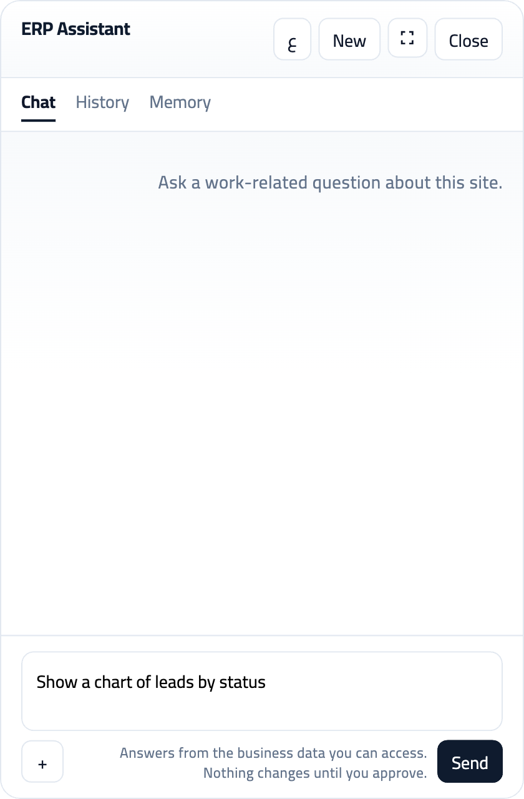

# The ERPNext-AI-Assistant

[](https://frappeframework.com)
[](https://erpnext.com)
[](#what-you-can-ask)
[](license.txt)
[](mailto:ahmad18189@gmail.com)

**An Arabic and English chat assistant for Frappe and ERPNext.**  
Ask how many customers you have, open the import screen, or prepare a new record. It only uses data your login can already see, and it does not save anything until you press Approve.

Made by **Ahmed Abdelrahman**. Support: [ahmad18189@gmail.com](mailto:ahmad18189@gmail.com).

`#frappe` `#erpnext` `#arabic` `#ai-assistant` `#hrms` `#crm` `#data-import` `#rtl` `#openai` `#desk`

## About this app

The ERPNext-AI-Assistant is a Frappe app you install on your own site. It adds a small chat panel on Desk. It works if the site has only Frappe, and it also works when ERPNext, HR, CRM, or your own apps are installed. You talk in Arabic or English. The assistant answers from your records, draws a simple chart, and can open a page inside Desk, such as Data Import.

It is not a public chatbot. Guests cannot use it. A staff member only sees the records their role already allows.

## What you can ask

The chat panel is the only thing on screen here. Type a question in English, then send it. The assistant answers from the records your login can already see.



*Ask in English. The panel stays on your site.*

| You say | What happens |
|---|---|
| How many customers? / كم عدد العملاء | A count of the records you are allowed to see. |
| Show a chart of leads by status | A chart from those records, plus the numbers in a sentence. |
| Open the import tool / افتح أداة الاستيراد | A button that stays on your site and opens Data Import. |
| Create a task for tomorrow | A draft. You review it and press Approve. Nothing is saved before that. |
| What can you do? / ماذا تستطيع | A short list of these same jobs. |

## What the chat does now

- Answers work questions about this site. A question in Arabic gets an Arabic reply.
- Counts and lists the records your role can already read.
- Draws a simple chart from those records and states the numbers in a sentence.
- Opens a page on the same Desk, such as Data Import.
- Prepares a new or updated record one field at a time, then waits for Approve.
- Checks a spreadsheet and starts the import only after you approve.
- Answers how-to questions from the ERPNext manual when ERPNext is installed.
- Saves a fact about you only after you confirm it.

## The aim

The aim is a companion for the Frappe site you already run. It should help when the site has only Frappe, and when ERPNext, HR, CRM, or your own apps are installed. A staff member asks in the Desk they already use, in Arabic or English, and only reaches the records their role allows.

## Future enhancements

- A question the chat cannot finish is stored on ERP AI Enhancement. A system manager reviews it and can accept it for a later release. The chat does not invent the missing action.
- Accepted gaps are the source for later work: more of the DocTypes already on the site, a clearer choice when a question could belong to more than one app, and steps the current tools cannot finish yet.
- The same limits stay in place. Reads follow your permissions. Creates, updates, and imports wait for Approve.

## Support

**Ahmed Abdelrahman**  
Email: [ahmad18189@gmail.com](mailto:ahmad18189@gmail.com)

Write with your Frappe version, the question you asked, and what the assistant replied. Do not send your API key.

## Questions people ask

**Does it work without ERPNext?**  
Yes. On a Frappe-only site it can still help with tasks, events, and notes.

**Will it change my data by itself?**  
No. Creates, updates, and imports wait for your approval.

**Which languages does it speak?**  
Arabic and English. The panel can switch with one button.

**Who is it for?**  
Companies that already use Frappe or ERPNext and want staff to ask questions in the same Desk they already use.

---

## What it does

| Capability | Behavior |
|---|---|
| Chat panel | FAB and overlay on Desk and on every installed app route. Header shows the resolved persona |
| Live reads | Session-user `get_list` / `count_records` / `get_doc` — **no** `ignore_permissions` |
| Arabic labels | Translated DocType and field index. A field name is used only when exactly one readable field matches |
| Desk links | "Open the import tool" returns a same-site `/desk/...` button. The model cannot supply the path |
| Writes | Schema check, then one missing field at a time, then **ERP AI Pending Action**. Nothing is saved until you approve |
| Personas | Roles first, then route, then the app implied by the message. A blank active persona is Frappe helper |
| Memory | Confirmed user facts only, plus rolling chat facts so a follow-up keeps the chosen DocType |
| Charts | Server-built SVG charts (no heavy chart libraries in the panel) |
| Moderation | Abuse term scan → event → threshold block; work-only gate before the model |
| Gaps | Unfinished turns are stored on **ERP AI Enhancement** for a later release. The model does not implement them |
| LLM | OpenAI-compatible chat. The model chooses an allowlisted tool; the server checks permission and schema |

Permissions and Frappe roles always win. Guests cannot chat.

---

## Architecture

```
┌─────────────────────────────────────────────────────────────┐
│  Any installed app + Desk                                  │
│  App routes from hooks → Overlay Pages → panel JS/CSS      │
│  FAB + panel (Cairo / RTL / navy)                           │
└───────────────────────────┬─────────────────────────────────┘
                            │ frappe.call run / approve_action
┌───────────────────────────▼─────────────────────────────────┐
│  api/chat.py  →  services/run_chat.py                       │
│                                                             │
│  1. Guest reject                                            │
│  2. Enabled gate        (Settings can turn the chat off)    │
│  3. Blocked User check                                      │
│  4. Ensure ERP AI Chat + Message                            │
│  5. Abuse scan          → contains_abuse on every response  │
│  6. Work-scope gate     (deterministic, no LLM)             │
│  7. Fixed "what can you do" list, before any model call     │
│  8. Memory + persona (roles, route, inferred app)          │
│  9. Desk link, chart, or count / list / create when the    │
│     match is clear. Otherwise the tool loop                │
│ 10. Detectors only when the model is off                    │
│ 11. Save the reply. Record an Enhancement row if the       │
│     turn could not be finished                              │
└─────────────────────────────────────────────────────────────┘
```

### Integration model

- This app **owns** panel JS/CSS (`public/js`, `public/css`).
- Any installed app can host the panel. Routes come from that app's `add_to_apps_screen` hook, plus Desk. Add more paths under ERP AI Settings → Overlay Pages.
- Desk loads assets through `app_include_js` / `app_include_css`.
- A host page may load the thin `crm_include.js` shim. The shim only inserts this app's bundle.

Do **not** put assistant CSS into a theme app.

### DocTypes (module: ERP AI Assistant)

| Area | DocTypes |
|---|---|
| Conversation | ERP AI Chat, ERP AI Message, ERP AI Generated Query, ERP AI Generated Chart |
| Knowledge | ERP AI Knowledge Document, ERP AI Knowledge Chunk, ERP AI Metadata Cache |
| Safety / writes | ERP AI Pending Action, ERP AI Abuse Event, ERP AI Audit Log, ERP AI Enhancement |
| Config | ERP AI Skill (+ Role), ERP AI Persona (+ Role), ERP AI Memory |
| Settings (Single) | Abuse Term, Notify Role, Blocked User, Overlay Page children |

**Workspace:** `The ERPNext-AI-Assistant` (System Manager).

**Reports:** ERP AI Chats by User · Abuse Summary · Pending Actions · Skill Usage · Memory Overview · Enhancements by Gap.

System Manager only can read Enhancement rows. A normal chat user cannot.

---

## Tool registry

All tools run as the **logged-in session user**. The model may call only `describe_doctype`, `query_records`, `count_records`, `list_doctypes`, `list_installed_apps`, `lookup_field`, `search_knowledge`, `search_manual` (when ERPNext is installed), and `propose_write`. The server checks permission and schema before any of those run. Knowledge search is keyword search with a role check. There is no embedding index.

### Read

| Tool | Purpose |
|---|---|
| `tool_rdf_lookup` | Metadata / name graph lookup (preferred before free-form name queries) |
| `tool_erp_query` | Permission-aware `frappe.get_list` |
| `tool_erp_get_doc` | Permission-aware `get_doc` |
| `tool_erp_report` | Query Report runner |
| `tool_get_doctype_meta` | Field labels / types for a DocType |
| `tool_run_method` | Allowlisted whitelisted methods only |
| `tool_read_doctype_controller` | Controller source (System Manager only) |
| `tool_list_installed_apps` | Describe installed apps on the site |
| `build_chart` | Aggregate + SVG chart payload |
| `read_skill` | Role- and route-filtered ERP AI Skill rows |

### Write

| Tool | Purpose |
|---|---|
| `propose_write` | Creates **ERP AI Pending Action** only |
| `approve_action` / `reject_action` | API: execute or cancel after written acknowledgment |

---

## Package layout

```
erpnext_ai_assistant/
├── README.md
├── pyproject.toml
├── docs/
│   ├── PLAN.md
│   ├── SRS.md
│   ├── architecture.md
│   └── TEST_RESULTS.md
└── erpnext_ai_assistant/
    ├── hooks.py
    ├── install.py                 # seeds settings, persona, skills, overlays
    ├── api/chat.py                # whitelisted run / approve / reject / boot
    ├── public/js|css/             # panel + CRM include
    ├── services/
    │   ├── run_chat.py            # orchestrator
    │   ├── cheat_sheet.py         # fixed "what can you do" list
    │   ├── intent.py              # DocType, app, action, confidence
    │   ├── persona.py             # roles, then route, then app
    │   ├── desk_link.py           # same-site /desk/ open button
    │   ├── enhancement.py         # unfinished-turn backlog
    │   ├── schema.py              # DocType contract for writes
    │   ├── writes.py              # payload hash + summary
    │   ├── apps.py                # installed app routes
    │   ├── imports.py             # import-template match
    │   ├── conversation.py        # newest history window
    │   ├── detectors.py           # fallback when the model is off
    │   ├── moderation/            # abuse + work_gate
    │   ├── llm/provider.py        # OpenAI-compatible client
    │   ├── rag/                   # retrieve, role-filtered
    │   ├── rdf/                   # label → fieldname
    │   ├── charts/                # SVG builders
    │   └── tools/
    │       ├── agent.py           # model-directed tool loop
    │       └── registry.py        # session-user tools
    ├── skills/                    # seed skill content
    └── erp_ai_assistant/          # DocTypes, Workspace, Reports
```

---

## Install

Requires **Frappe v16**. ERPNext, HRMS, and CRM are optional. A Frappe-only site still answers ToDo, Event, and Note questions.

Install inserts missing settings, the Frappe helper persona, and the Frappe core skill. It does not overwrite a value you already saved, including a call cap of 0. Optional ERPNext, CRM, HR, stock, and finance seeds are added only when that app or DocType is installed. Set the API key after install. The key is never written by the seed.

```bash
cd /path/to/frappe-bench
bench get-app https://github.com/ahmad18189/erpnext_ai_assistant.git
bench --site your.site install-app erpnext_ai_assistant
bench --site your.site migrate
bench build --app erpnext_ai_assistant
bench --site your.site clear-cache
```

### Configure the LLM key (do not commit secrets)

Prefer one of:

1. **Desk:** ERP AI Settings → **API Key** (Password field)
2. **site_config.json** (server only):

```json
{
  "erp_ai_openai_api_key": "YOUR_OPENAI_API_KEY"
}
```

3. Environment: `OPENAI_API_KEY` or `ERP_AI_API_KEY`

Optional Settings fields: `provider_base_url` (default OpenAI), `model` (default `gpt-4o-mini`), temperature, max tokens, panel title and hints, Overlay Pages, abuse thresholds.

### Where the panel appears

Install adds an Overlay Page for `/desk`, `/app`, and each installed app route from `add_to_apps_screen` or `app_icon_route`. Add or disable paths under ERP AI Settings → Overlay Pages. The assistant then works on that app, not only on one product.

---

## API surface (session user)

| Method | Role |
|---|---|
| `erpnext_ai_assistant.api.chat.run` | Send a message; returns answer + `contains_abuse` + charts/pending |
| `erpnext_ai_assistant.api.chat.upload_attachment` | Private upload of an image, CSV, XLSX, PDF, or text file |
| `erpnext_ai_assistant.api.chat.blank_import_template` | CSV header row for one DocType, same columns as a Frappe blank import |
| `erpnext_ai_assistant.api.chat.approve_action` | Execute pending write after ack |
| `erpnext_ai_assistant.api.chat.reject_action` | Cancel pending write |
| `erpnext_ai_assistant.api.chat.bootstrap` | Panel boot (persona, branding, overlays, blocked flag) |

Every `run` response includes:

```json
{
  "status": "complete | refused_abuse | refused_work | blocked | …",
  "contains_abuse": false,
  "abuse": {
    "hit": false,
    "category": null,
    "score": 0,
    "matched": [],
    "event_name": null,
    "blocked_now": false
  },
  "message": "…",
  "chat_id": "…",
  "charts": [],
  "pending_action": null
}
```

Realtime thinking steps publish on `erp_ai_thinking` / room `erp_ai_chat:{chat_id}`.

---

## Files and Data Import review

The composer accepts images, CSV, XLSX, PDF, and plain text (5 MB). Files are stored as private Frappe Files owned by the signed-in user.

- **Images** are sent to the model as image input so it can read them. They are not written into ERP documents.
- **CSV / XLSX** are compared with Frappe Data Import templates. A template is the target DocType's importable columns (field names and labels, including child-table columns). The reply ranks the closest DocTypes and lists mapped columns, required fields that are missing, and file columns that do not match a field.
- **Blank template.** Each suggestion can download a one-row CSV header for that DocType. That is the same column list you would start from in Desk → Data Import → Download Template, without sample records.
- **Guided import.** When the header matches one DocType you may import, the assistant builds a corrected file (header renames only; cell values stay as you wrote them) and a warning-row file. Approve the card to create one Data Import and start it. The reply quotes Success, Partial Success, Error, Timed Out, still running, or blocked. Failed rows can be downloaded. Ask "ماذا حدث للاستيراد" later for the same status.
- **Open the tool.** "افتح أداة الاستيراد" still returns a button to `/desk/data-import` when you can read Data Import.

## Security model

- **No Guest** chat.
- ERP reads/writes use the **session user** only.
- Abuse list is seeded + always unioned at scan time; hits create **ERP AI Abuse Event**.
- Threshold on Settings can append **Blocked User** and notify manager roles.
- Writes require a checkbox and acknowledgment text. The payload is hashed and cannot be edited before `approve_action`. Approval runs once.
- Uploaded files are private to the signed-in user. A spreadsheet match does not insert rows.
- API keys must live in Password / `site_config` / env — **never** in this repository.
- Enhancement excerpts are System Manager only and are not copied into the knowledge index.

---

## Development docs

| Doc | Contents |
|---|---|
| [`docs/PLAN.md`](docs/PLAN.md) | Product decisions and scope |
| [`docs/SRS.md`](docs/SRS.md) | Functional requirements |
| [`docs/architecture.md`](docs/architecture.md) | Pipeline, DocTypes, tools |
| [`docs/TEST_RESULTS.md`](docs/TEST_RESULTS.md) | Pipeline test IDs |

Run app tests (bench):

```bash
bench --site your.site run-tests --app erpnext_ai_assistant
```

---

## License

MIT — see [`license.txt`](license.txt).
